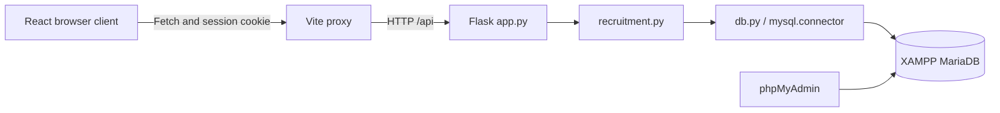
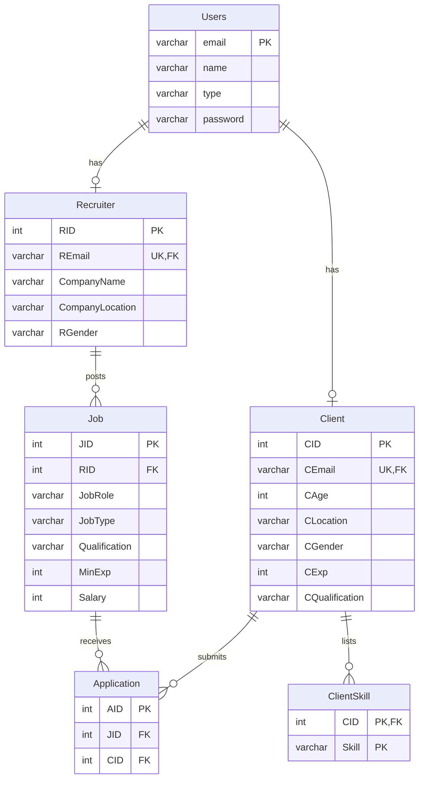

# Architecture

## Components and request flow

| Component | Responsibility |
| --- | --- |
| `frontend/src/App.jsx` | Session restoration, workspace navigation, records and mutations |
| `frontend/src/pages/Auth.jsx` | Role-specific registration and sign-in |
| `frontend/src/components/Field.jsx` | Labeled native form controls |
| `frontend/src/api.js` | JSON requests, cookies, timeouts and HTTP errors |
| `backend/app.py` | Configuration, sessions, endpoints and JSON errors |
| `backend/recruitment.py` | Validation, authorization and recruitment SQL |
| `backend/db.py` | Connections, environment loading, commit, rollback and cleanup |
| `backend/migrate_db.py` | Backed-up, restartable legacy schema upgrade |
| `database/` | Canonical schema, demonstration queries, view and integrity triggers |

React communicates only with Flask through the same-origin Vite proxy. Database credentials remain in the backend. Navigation uses component state; filtering and sorting operate on fetched records without pagination. The workspace remounts when the account changes, and request generations prevent stale refresh results from replacing newer data.

## Implemented ER model

Application additionally has the candidate key `(CID, JID)`. Each profile has exactly one account; a Users row can have zero or one matching profile at the database level. Registration creates exactly one profile atomically. Five triggers reject wrong-role profile inserts/updates and changes to an account role while its profile exists. Recruiter and Client are disjoint role specializations. ClientSkill is identified by its parent CID and skill value; Application is an association entity with a surrogate key.

## Normalization and functional dependencies

The six implemented relations are in BCNF with respect to the dependencies below. Names, locations and company names are not assumed unique. In particular, company name does not determine company location: a company may operate at multiple locations. Skill values are individual case-sensitive strings, not lists.

The notation `X -> {a, b}` abbreviates the two singleton dependencies `X -> a` and `X -> b`. These are minimal covers, not extra database columns.

| Relation | Candidate keys | Minimal cover |
| --- | --- | --- |
| Users | email | email -> {name, type, password} |
| Recruiter | RID; REmail | RID -> {REmail, CompanyName, CompanyLocation, RGender}; REmail -> RID |
| Client | CID; CEmail | CID -> {CEmail, CAge, CLocation, CGender, CExp, CQualification}; CEmail -> CID |
| ClientSkill | (CID, Skill) | Empty: no nontrivial functional dependencies |
| Job | JID | JID -> {RID, JobRole, JobType, Qualification, MinExp, Salary} |
| Application | AID; (CID, JID) | AID -> {CID, JID}; (CID, JID) -> AID |

Each nontrivial determinant is a candidate key. All attributes are atomic (1NF); non-key attributes depend on whole candidate keys (2NF); there are no non-key transitive determinants (3NF); every nontrivial determinant is a superkey (BCNF). ClientSkill satisfies BCNF vacuously under the stated dependency set.

### Implemented decompositions

- **Application ownership:** the legacy `Application(AID, RID, JID, CID)` stored `JID -> RID`, where JID was not a superkey. RID is now obtained from Job. The decomposition into `(AID, JID, CID)` and `(JID, RID)` is lossless because their intersection JID determines `(JID, RID)`. The latter relation already exists as a projection of Job and is not duplicated physically. The foreign key guarantees each application finds exactly one job.
- **Names:** RName and CName were copies of Users.name. A profile decomposes into its remaining attributes and `(email, name)`. The common email determines the name, so the decomposition is lossless. Users already stores the name relation. The migration requires the legacy names to agree before removing copies. API aliases RName and CName preserve response compatibility.
- **Skills:** individual values are stored in `ClientSkill(CID, Skill)`. For a logical expanded relation `(CID, profile attributes, Skill)`, decomposition into Client and ClientSkill is lossless because CID determines the Client attributes. Profiles with no skills remain in Client and are displayed with a left join or an equivalent correlated aggregate. Parsing a legacy comma-separated string preserves the set of skills, not its punctuation, order or repeated tokens; the automatic backup preserves the original text.

These decompositions preserve the stated dependencies. Application keeps `AID -> CID, JID` and `(CID, JID) -> AID`; Job keeps `JID -> RID`, hence `AID -> RID` remains derivable. After renaming profile email columns to the common logical email domain, `RID -> email -> name` and `CID -> email -> name` remain derivable from Recruiter/Client and Users. Client profile dependencies stay in Client; no nontrivial skill dependency is lost.

## API contract

| Method | Endpoint | Access and response |
| --- | --- | --- |
| GET | `/api/health` | Public database connectivity: status, database |
| POST | `/api/register` | Create account/profile/skills and session; user, HTTP 201 |
| POST | `/api/login` | Authenticate; user |
| POST | `/api/logout` | Clear session; message |
| GET | `/api/me` | Current account and profile; user |
| GET | `/api/jobs` | All jobs for clients; owned jobs for recruiters; jobs |
| POST | `/api/jobs` | Recruiter creates a posting; id, HTTP 201 |
| DELETE | `/api/jobs/<id>` | Owning recruiter deletes job and its applications; message |
| POST | `/api/jobs/<id>/apply` | Client applies; id, HTTP 201 |
| GET | `/api/applications` | Client submissions or owned-job candidates; applications |
| DELETE | `/api/applications/<id>` | Owning client withdraws; message |

Mutation requests use JSON and `X-Requested-With: job-web`. Errors use `{ "error": "message" }`: 400 for validation, 401 for authentication, 403 for role/origin rejection, 404 for unavailable owned records, 409 for duplicates/integrity conflicts, 413 for oversized bodies, 503 for database failures and 500 for unexpected errors. Internal exception text is not returned. Health checks connectivity, not schema completeness.

## Authentication and transactions

Flask reloads the account and role profile on protected requests. Operations receive that verified account, not an owner supplied by the browser. SQL values use bound parameters; interpolated query fragments are fixed source constants.

New passwords use Werkzeug's salted scrypt hashes. Successful legacy plaintext login upgrades the password transactionally. A random SECRET_KEY of at least 32 characters is required. The signed HttpOnly, SameSite=Lax cookie contains email/session metadata; activity refreshes its eight-hour lifetime. Browser mutation origins must match ALLOWED_ORIGINS. JSON and the custom header block ordinary cross-site form submissions; no permissive CORS is enabled. Local HTTP uses COOKIE_SECURE=false; HTTPS requires true.

Successful database operations commit; exceptions roll back; connections and cursors close in finally blocks. Registration writes Users, the profile and skill rows in one transaction. Job deletion verifies ownership and deletes applications before the job in one transaction. Applying and deleting lock the same Job row. A locking duplicate check gives a useful error; the unique `(CID, JID)` constraint also protects direct SQL writers. InnoDB supplies locking and undo/redo recovery. DDL migration is separate because MariaDB schema changes commit implicitly.

## SQL and operation

`queries.sql` demonstrates selection, projection, joins, EXISTS/NOT EXISTS, GROUP BY/HAVING, aggregate subqueries, a CTE, exact skill matching and transactional DML in a temporary table. `job_web_activity` counts applications, including zero-count jobs, using invoker permissions. No date-range query is claimed because the schema has no date fields.

Keys and foreign-key indexes support identity and join lookups. InnoDB handles scheduling, storage and crash recovery; the application does not implement timestamp protocols or custom hashing/storage. Logical backups complement engine logs. Durability depends on MariaDB and storage configuration.

`local.ps1` manages Flask/Vite on Windows with project-relative paths and ignored process state. XAMPP is managed separately. `test_api.py` tests isolated backend boundaries; `api.test.js` tests the HTTP client; `verify_live.py` tests actual HTTP, SQL, constraints, all five triggers and fixture cleanup. See SETUP.md for fresh installation and existing-database migration.
