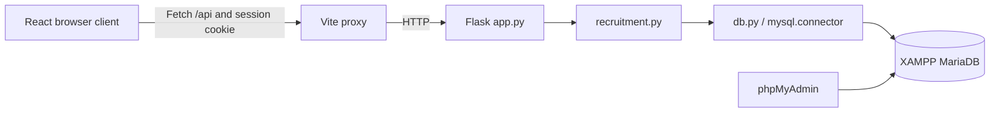
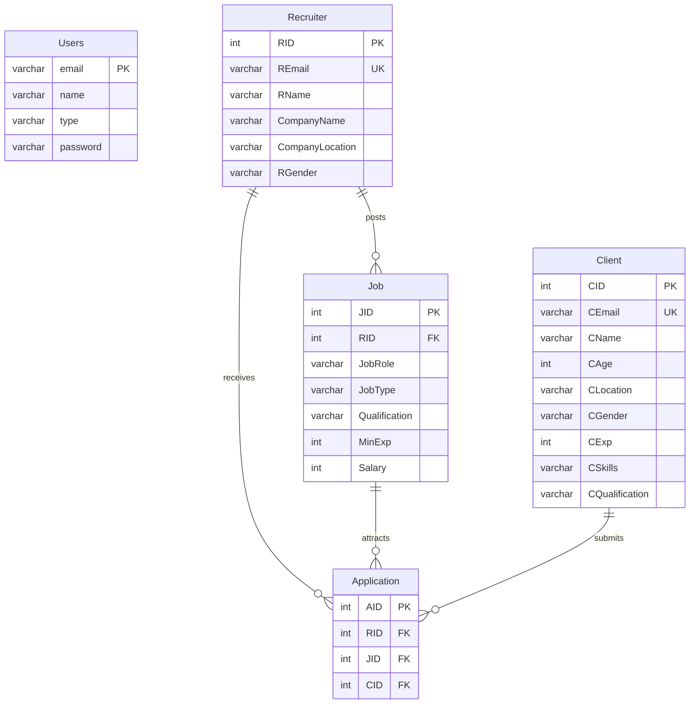

# Architecture

## Components and request flow

| Component | Responsibility |
| --- | --- |
| `frontend/src/App.jsx` | Session restoration and authenticated workspace state, navigation, lists, and mutations |
| `frontend/src/pages/Auth.jsx` | Role-specific registration and sign-in forms |
| `frontend/src/components/Field.jsx` | Shared labeled native form controls |
| `frontend/src/api.js` | JSON requests, session cookies, timeouts, and HTTP errors |
| `backend/app.py` | Configuration, sessions, HTTP endpoints, authorization entry points, and JSON errors |
| `backend/recruitment.py` | Validation and SQL-backed recruitment operations |
| `backend/db.py` | Environment loading, connections, transaction commit/rollback, and cleanup |
| `database/` | Canonical schema and supporting SQL resources |

React communicates only with Flask through the same-origin Vite proxy. Database credentials stay in the backend. Workspace navigation uses component state rather than URL routes. Filtering and sorting operate on fetched records; lists are not paginated. The authenticated workspace remounts on an account change, and request generations prevent late refresh results from replacing newer data.

Flask reloads the account and role profile for each protected request. Business operations receive that verified account rather than accepting an owner ID from the browser. SQL values use bound parameters. The only interpolated profile table/column names come from a fixed, validated role mapping.

## Database model

The diagram shows the four actual foreign keys. Users links to a role profile by email at the application level; the original schema has no Users/profile foreign key. Registration inserts both records atomically. Recruiter and Client represent role-specific profiles, and Application is an association entity with a surrogate key.

`schema.sql` retains the original tables, keys, and relationships. Fresh tables explicitly use InnoDB and utf8mb4. The legacy password column is widened only when narrower than 255 characters. Existing tables, encodings, records, and custom wider password columns are not automatically replaced. The original duplicate Python schema constants were removed because the application did not import them and they described obsolete password storage; SQL is now the single maintained definition.

## API contract

| Method | Endpoint | Access and result |
| --- | --- | --- |
| GET | `/api/health` | Public connectivity check: `status`, `database` |
| POST | `/api/register` | Create an account/profile and session; `user`, HTTP 201 |
| POST | `/api/login` | Authenticate and establish a session; `user` |
| POST | `/api/logout` | Clear the session; `message` |
| GET | `/api/me` | Authenticated user and profile; `user` |
| GET | `/api/jobs` | All jobs for clients; owned jobs for recruiters; `jobs` |
| POST | `/api/jobs` | Recruiter creates a posting; `id`, HTTP 201 |
| DELETE | `/api/jobs/<id>` | Owning recruiter deletes posting and applications; `message` |
| POST | `/api/jobs/<id>/apply` | Client applies; `id`, HTTP 201 |
| GET | `/api/applications` | Client submissions or owned-job candidates; `applications` |
| DELETE | `/api/applications/<id>` | Owning client withdraws; `message` |

Mutation requests use JSON and `X-Requested-With: job-web`. Errors return `{ "error": "message" }`: 400 for validation, 401 for missing/invalid authentication, 403 for role or origin rejection, 404 for unavailable owned records, 409 for duplicates or integrity conflicts, 413 for oversized bodies, 503 for database failures, and 500 for unexpected server failures. Internal exception text is not returned to clients. The health endpoint checks connectivity only; it does not validate all schema objects.

## Authentication and authorization

Werkzeug's salted scrypt hashes protect new passwords. A successful legacy plaintext login replaces the password with a hash in the same transaction. A valid random `SECRET_KEY` is required at startup. Flask signs an HttpOnly, SameSite=Lax cookie containing the email and session metadata; no password or applicant record is stored in it. Activity refreshes the eight-hour session lifetime.

Browser mutation origins must match `ALLOWED_ORIGINS`; JSON and the custom header prevent ordinary cross-site forms from issuing mutations. No cross-origin access policy is enabled. Local HTTP requires `COOKIE_SECURE=false`; an HTTPS deployment must enable it. The application is configured for loopback development and does not include production hosting, rate limiting, or account recovery.

Recruiter operations use the authenticated RID, and withdrawals include the authenticated CID. Job deletion locks and verifies the owned job before removing dependent applications. Unknown roles and missing profiles fail closed. Backend and frontend error handling preserve HTTP status codes so session expiry is distinguishable from database outages.

## Transactions and concurrency

Each database operation uses a context-managed connection. Successful operations commit; exceptions roll back; cursor and connection cleanup run even when cleanup itself fails. Registration and job deletion are multi-statement transactions. InnoDB is required for their atomicity.

Applying and deleting a job acquire the same Job-row lock using `SELECT ... FOR UPDATE`. Concurrent API applications serialize on that row and recheck for an existing client/job pair with a locking read. This prevents duplicate submissions through the API while preserving the source schema, which has no unique constraint on `(CID, JID)`. Direct SQL writers must observe that invariant themselves. Database lock failures are reported as database errors and can be retried.

## SQL resources and design tradeoffs

`queries.sql` demonstrates selection, projection, joins, EXISTS/NOT EXISTS, grouping/HAVING, aggregate subqueries, and CTEs using recruitment records. Its DML exercise operates on a temporary table and rolls back. `job_web_activity` summarizes application counts, including zero-count jobs, using invoker permissions. Optional triggers reject mismatched recruiter/job references on Application inserts and updates. They do not prevent a direct administrator change to Job.RID; the API never changes job ownership.

The schema retains compatibility tradeoffs: Application stores RID even though a job determines its recruiter; Users duplicates profile names/emails; skills are stored as a string. These prevent a blanket claim of 3NF/BCNF compliance. Primary keys determine their row attributes, and the foreign-key joins preserve the intended one-to-many relationships. No additional entities or date fields are introduced for academic demonstrations.

InnoDB supplies locking, undo/redo logging, crash recovery, and indexed storage. Primary and foreign-key indexes support lookups and joins. Durability depends on database configuration and storage; logical phpMyAdmin exports provide backups but do not replace engine recovery logs. Physical storage and scheduling protocols remain database responsibilities rather than application modules.

## Development tools

`local.ps1` optionally manages Flask and Vite processes on Windows. It derives paths from the script location and keeps ignored process state inside the project; XAMPP stays independently managed. `test_api.py` covers isolated backend behavior, `api.test.js` covers the HTTP client, and `verify_live.py` exercises real HTTP/database operations with disposable fixtures. No database initialization runs automatically when Flask starts.
